

# Fresh Exile

**A levelling and trade overlay for Path of Exile, driven by your Path of Building.**

English · [Русский](README.ru.md)

Paste a Path of Building link once. Fresh Exile follows the game's log and shows, for the stage you are on,
which gems to buy and where, how to link them, which passives to take next — drawn right on the game's own tree —
and what your gear should look like. One hotkey prices any item under the mouse.

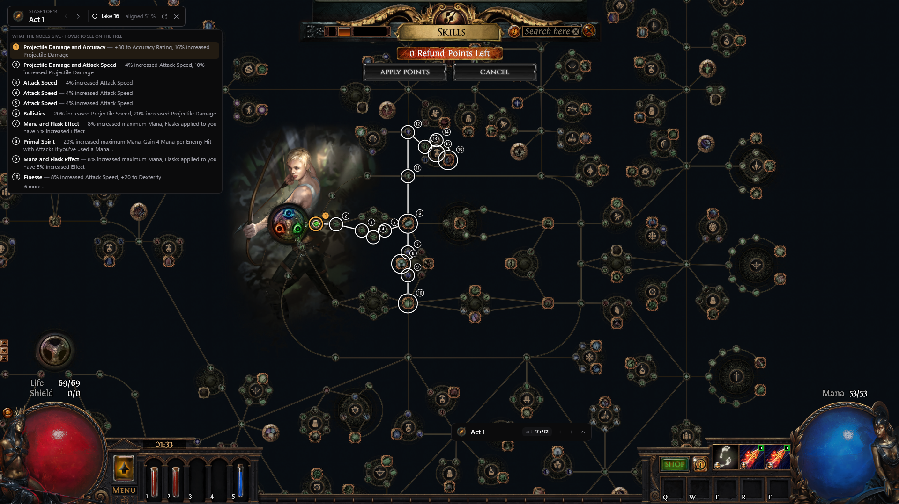

  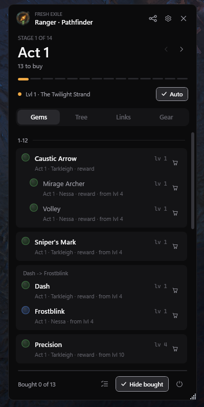
  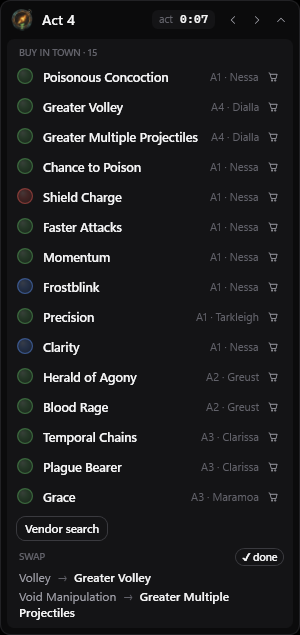
  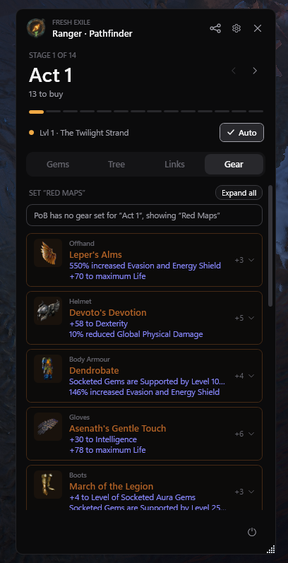

## Features

### Levelling guide from your PoB
- **Stages** are your PoB's trees and gem sets (`Act 1`, `Act 2`, …, `Early Maps`). Names are matched loosely,
  `Act 7+` covers Acts 7–10, a stage without its own gem set keeps the previous one.
- **Follows the game**: reads `Client.txt`, shows your level and zone and moves to the next stage by act or level
  (forward only). A new character in the log offers to start the build from stage 1.
- **Gems**: grouped by socket group, coloured by gem, with where *your class* gets each one — act, NPC, quest reward or
  vendor, and from which level. `NEW` marks gems that were not on the previous stage; ticks remember what you bought.
- **Vendor search**: one click copies a search string for the gems the vendor sells right now — paste it into the NPC window.
- **Link swaps**: what to change in existing sockets when a stage starts, plus bandits and pantheon.

  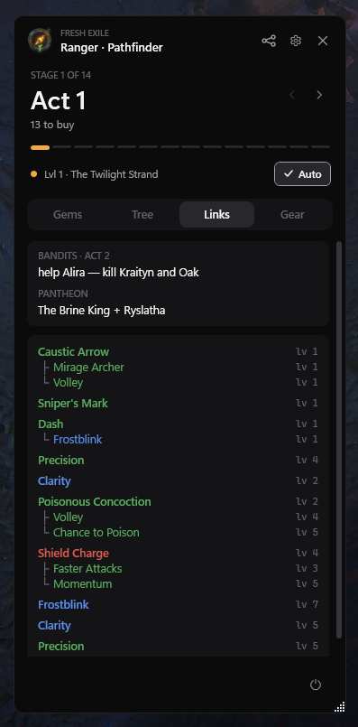
  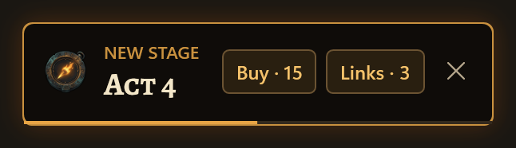

### Mini tracker
One line while you run maps or acts: stage, act or map timer, next / previous. In town it unfolds into the shopping list
and the link swaps, and folds back when you leave. The act timer runs from the act's first zone (a trip back to an older
town counts to the current act); the map timer stops in the hideout and runs on if you go back into the same map.
Both survive a restart of the overlay while the game is running.

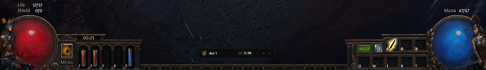

### Passive tree
- **Tree window** with the stage's path numbered in the order to take it: nearest notables, keystones and masteries first,
  small passives after. Refunds are crossed out; compare with the previous stage or with your real character.
- **On the game's tree**: open the tree in game (`P`) and the path lies right on its nodes, clicks go through to the game.
  The scale is found by itself and remembered for each zoom level.
- **Cluster jewels** are grown into the tree the way Path of Building and the game draw them, so the path goes through
  their notables too. Until the jewel is socketed the game shows none of its passives: the overlay draws them in the
  game's own art.
- **Which jewel goes where**: every socket on the path gets a card with the stage's jewel for it — a cluster with its
  notables, or a plain jewel; settings can show every mod.

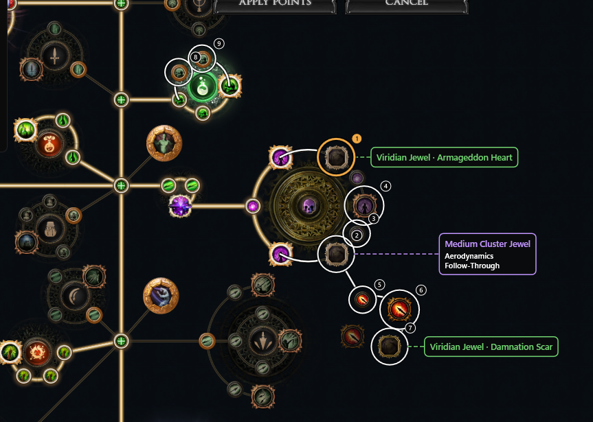

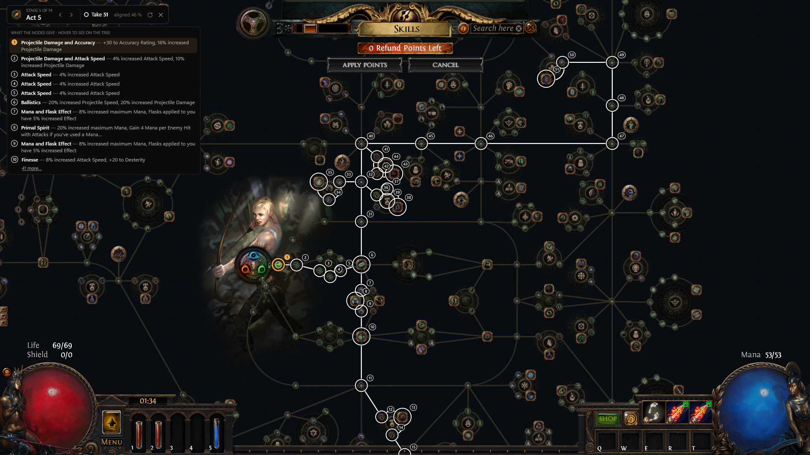

  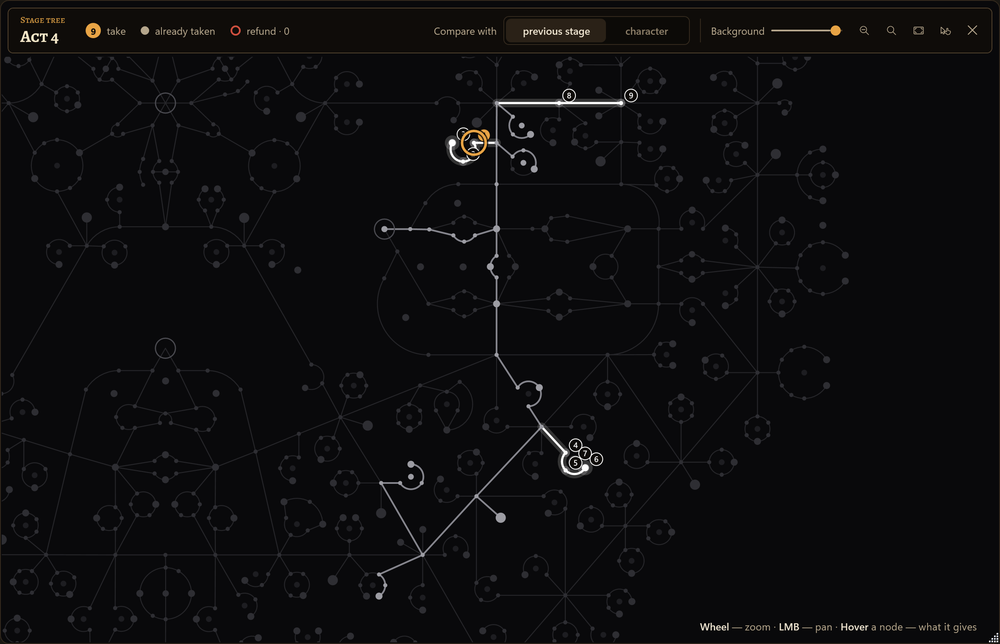
  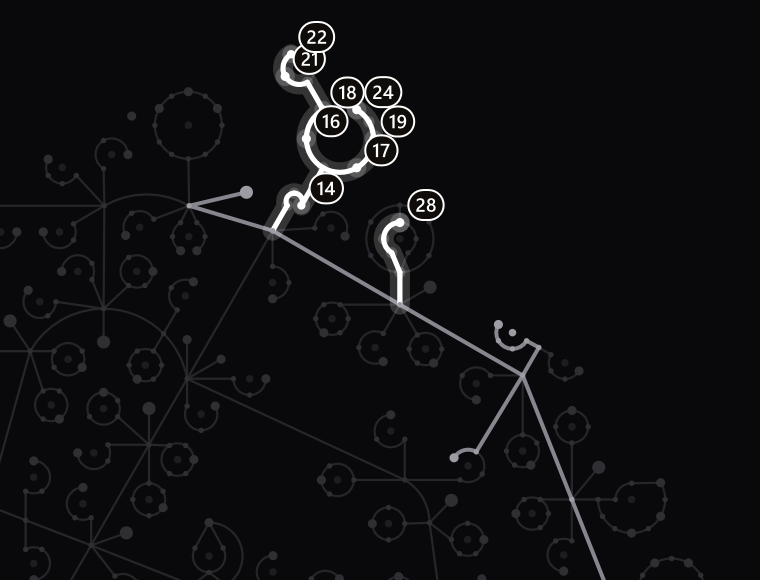

### Gear
- The stage's PoB item set as compact rows; a click opens the card drawn like the game's tooltip, with the item art.
- **Anointments** show their three oils — hover an oil for its name.
- **Jewels in the tree** in a group of their own: for a cluster, which of its notables your tree takes and how many
  small passives; for a timeless jewel, its seed and a link to what it does in that socket.

  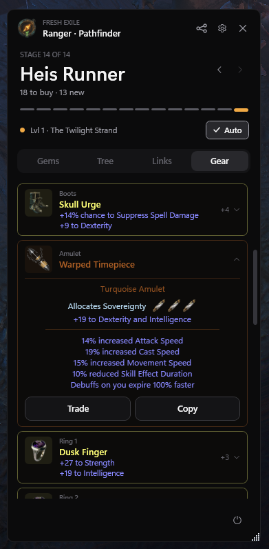
  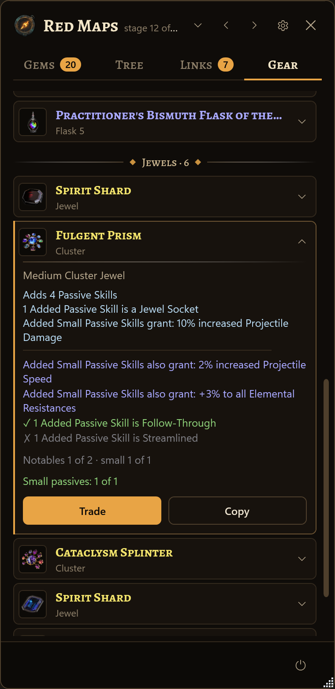

### Price check
- `Ctrl+Alt+D` over an item in game: a window with its mods and tiers, resistance and life totals, defences at 20% quality
  and the cheapest listings from the trade site. Filters are pre-ticked on what makes the price; minimums are a share
  of the item's own rolls.
- Compare any listing with your item line by line; top mods (+1 charges, gem levels, immunities…) are starred.
- Uniques also show their poe.ninja price; currency and league items (crystals, essences…) the market rate, the one
  the in-game currency exchange trades at.
- **Whisper** on an "in person" listing puts the seller's message straight into the game's chat.
- A gem's **Trade** button in the build opens the same window for that gem: any level for a gem that levels on the
  way, the build's level for Enlighten, Empower, Enhance and awakened gems.
- **Smart cluster search**: your build's notables are required, and the free places may be any notable that sits
  *off their path* on the ring — so you never pay for a jewel that makes you walk through a notable you don't want.

  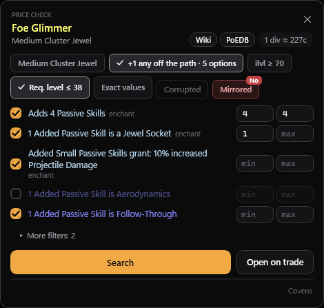

### And also
- **Settings** in their own window; the interface in English or Russian.
- **Character sync** from your public profile: ticks gems you already have socketed and compares the tree with your character.
- **Alt+Tab aware**: while another program is in front, the overlay goes transparent and lets clicks through.
- **The panel steps aside** when you open the inventory.

  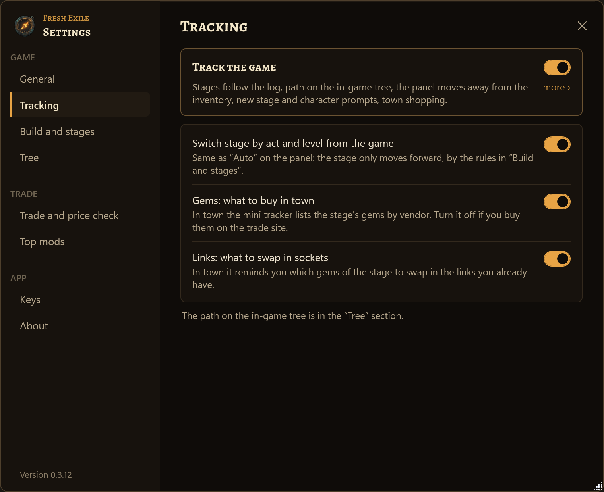

## Install

1. Download the latest `FreshExile.zip` from **[Releases](https://github.com/freshexileapp/FreshExile/releases/latest)** and unzip it anywhere.
2. Run `FreshExile.exe`. Windows 10 / 11, 64-bit.
3. Paste a pobb.in / pastebin link or a PoB code and press **Load build**.
4. Set the game to **Windowed Fullscreen**.
5. Play with the game in **English**: for now the log tracking and the price check read the game's English texts only.

The game's log is found automatically from the running game; otherwise point to it in *Settings → General*.

From 0.3.9 on the app updates itself: a new release is downloaded in the background and takes the exe's place when you
close the app (*Settings → About*).

## Hotkeys

| Keys | Action |
|---|---|
| `Ctrl+Alt+G` | show / hide the panel |
| `Ctrl+Alt+C` | panel: compact / full |
| `Ctrl+Alt+T` | show / hide the tree window |
| `Ctrl+Alt+E` | tree window: clicks through on / off |
| `Ctrl+Alt+←` / `→` | previous / next stage |
| `Ctrl+Alt+D` | price check the item under the mouse (taken only while the game is in front) |
| `Ctrl+Alt+F` | search the trade by name (maps, uniques, currency…), no item needed; the result opens in the price check window |

All of them can be changed in *Settings → Keys*.

## Plays by GGG's rules

Fresh Exile reads the game's log file and the public pathofexile.com API and draws its own window over the game.
It never reads the game's memory. The only keystrokes it sends to the game are `Ctrl+Alt+C` (copy the item) — once per
press of the price check hotkey — and Enter, Ctrl+V, Enter for one whisper per click of **Whisper**, as Awakened PoE
Trade and similar tools do. Trade requests are made only on your
action and never faster than the site allows. The tree overlay looks at a screenshot of the game; with tracking off
in the settings, the screen is never captured at all.

## Credits

- [Path of Building Community](https://github.com/PathOfBuildingCommunity/PathOfBuilding) — the build format and the way
  cluster jewels are laid out.
- [grindinggear/skilltree-export](https://github.com/grindinggear/skilltree-export) — the passive tree and oil recipes.
- [HeartofPhos/exile-leveling](https://github.com/HeartofPhos/exile-leveling) (MIT) — where each gem comes from.
- [RePoE](https://github.com/repoe-fork/repoe-fork.github.io) — mod tiers and cluster notables.
- [poe.ninja](https://poe.ninja) — unique and currency prices.

## License

[MIT](LICENSE).

Fresh Exile is a fan project and is not affiliated with or endorsed by Grinding Gear Games.

Building from source: see [docs/development.md](docs/development.md).
