

# Fresh Exile

**Оверлей для прокачки и трейда в Path of Exile по вашему билду из Path of Building.**

[English](README.md) · Русский

Один раз вставьте ссылку на Path of Building. Fresh Exile следит за логом игры и для текущего этапа показывает, какие гемы
купить и где, как их связать, какие пассивки брать дальше — прямо на игровом дереве — и каким должен быть шмот.
Одна горячая клавиша — и цена любого предмета под мышкой.

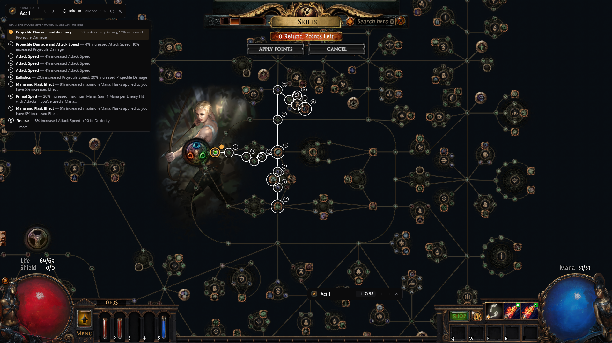

  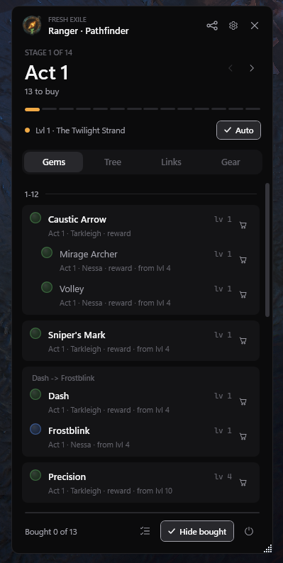
  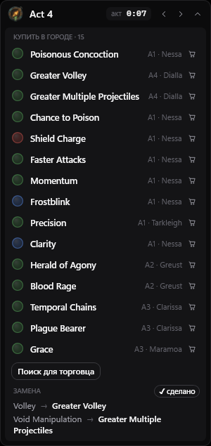
  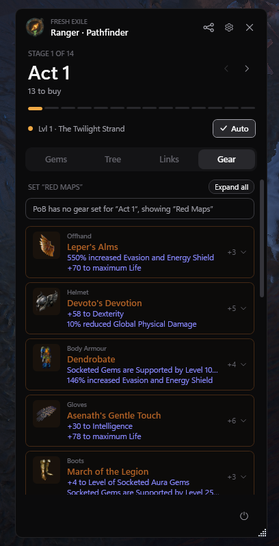

## Возможности

### Гайд прокачки по вашему PoB
- **Этапы** — это деревья и наборы гемов из PoB (`Act 1`, `Act 2`, …, `Early Maps`). Названия сопоставляются с опечатками,
  `Act 7+` покрывает акты 7–10, а этап без своего набора гемов берёт набор прошлого.
- **Следит за игрой**: читает `Client.txt`, показывает уровень и зону и сам переходит на следующий этап по акту или уровню
  (только вперёд). Новый персонаж в логе — предложит начать билд с этапа 1.
- **Гемы**: по группам сокетов, в цвет гема, и для каждого — где его берёт *ваш класс*: акт, NPC, награда за квест или
  покупка, с какого уровня. Метка `NEW` у гемов, которых не было на прошлом этапе; отметки «куплено» запоминаются.
- **Поиск для торговца**: одна кнопка копирует строку поиска по гемам, которые торговец продаёт прямо сейчас, —
  вставьте её в окно NPC.
- **Смена связок**: что переставить в сокетах на новом этапе, плюс бандиты и пантеон.

  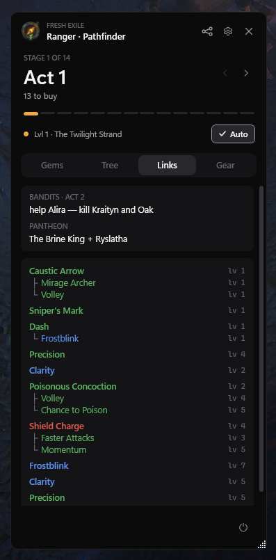
  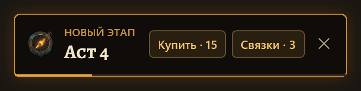

### Мини-трекер
Одна строка, пока бежите по карте или акту: этап, таймер акта или карты, вперёд / назад. В городе разворачивается
в список покупок и смену связок и сворачивается обратно, когда выходите. Таймер акта идёт с первой зоны акта (заход
в старый город считается в текущий акт); таймер карты стоит в хайдауте и идёт дальше, если вернуться в ту же карту.
Оба переживают перезапуск программы, пока игра запущена.

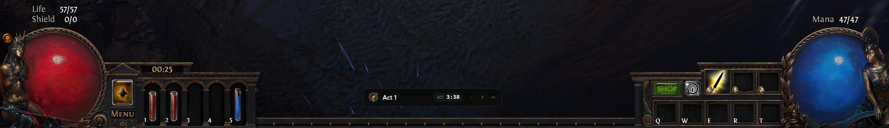

### Дерево пассивок
- **Окно дерева**: путь этапа с номерами в порядке взятия — сначала ближайшие нотабли, кейстоуны и мастерства, мелочь потом.
  Что снимать при респеке — перечёркнуто; сравнение с прошлым этапом или с реальным персонажем.
- **На игровом дереве**: откройте дерево в игре (`P`) — путь лежит прямо на его узлах, клики проходят в игру.
  Масштаб подбирается сам и запоминается для каждого зума.
- **Кластерные самоцветы** встраиваются в дерево так же, как их рисуют Path of Building и игра, и путь идёт через их нотабли.
  Пока кластер не вставлен, игра его узлов не показывает — оверлей дорисовывает их игровыми иконками.
- **Какой самоцвет в какое гнездо**: у каждого гнезда на пути карточка с самоцветом этапа — кластер с его нотаблями
  или обычный самоцвет; в настройках можно показывать все моды.

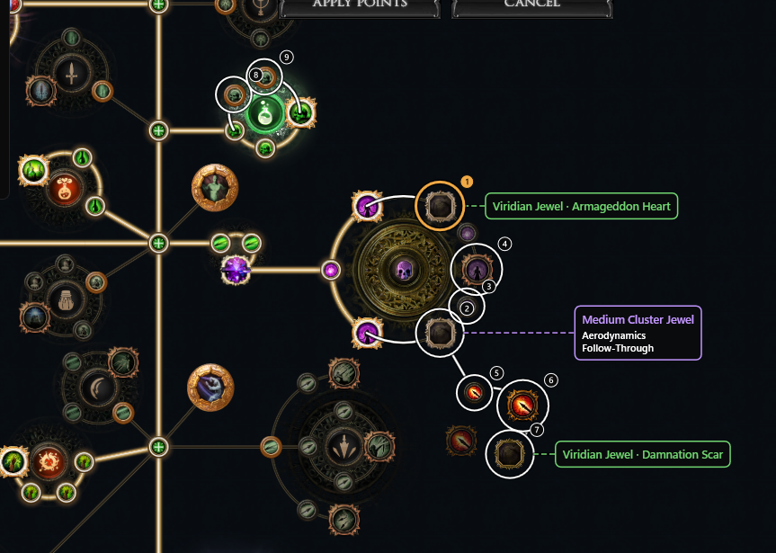

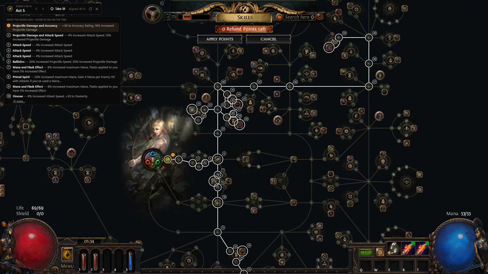

  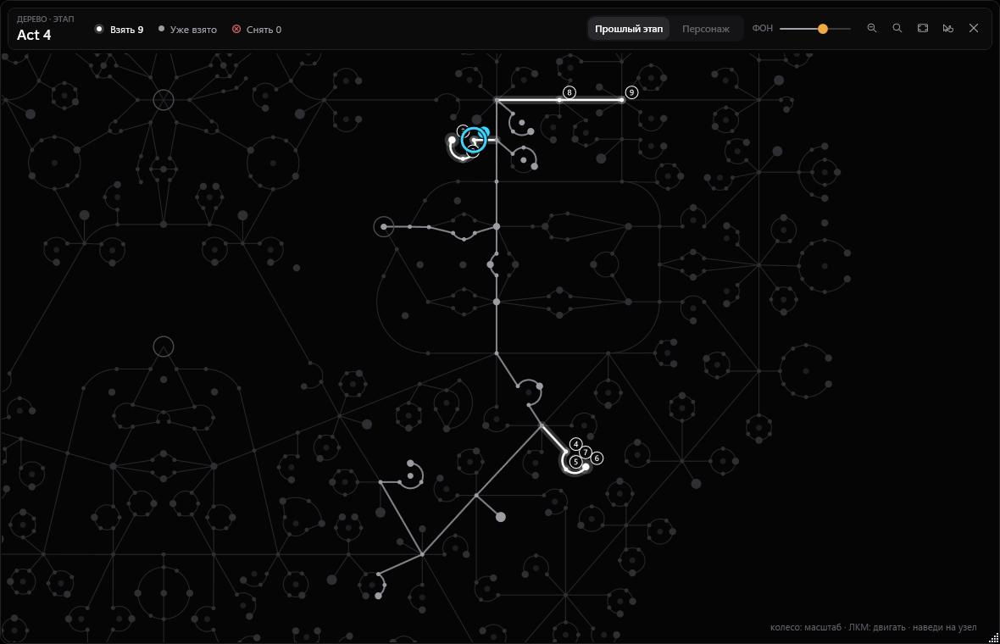
  

### Шмот
- Набор шмота этапа из PoB — компактными строками; клик открывает карточку как игровая подсказка, с картинкой предмета.
- **Намазка** показывает свои три масла — наведите на масло, чтобы увидеть название.
- **Самоцветы в дереве** отдельной группой: у кластера — какие нотабли берёт ваше дерево и сколько малых пассивок;
  у вечного самоцвета — сид и ссылка на то, что он даёт в этом сокете.

  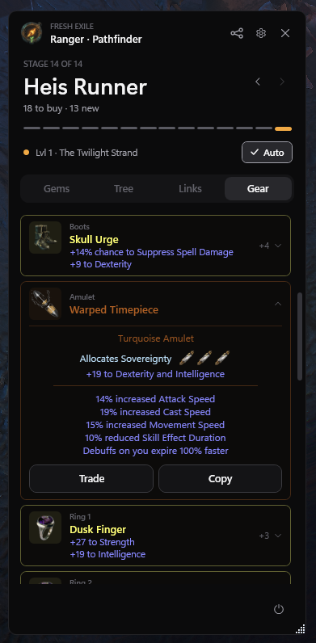
  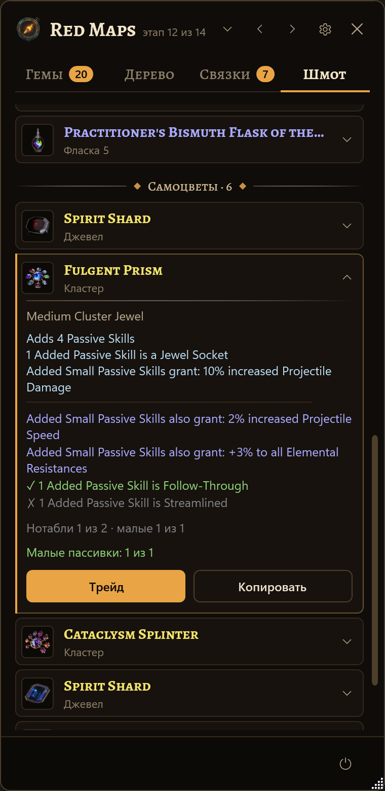

### Прайс-чек
- `Ctrl+Alt+D` над предметом в игре: окно с модами и тирами, суммой сопротивлений и здоровья, защитой при 20% качества
  и самыми дешёвыми предложениями с трейда. Галочки уже стоят на том, что делает цену; минимумы — доля от роллов предмета.
- Любое предложение можно сравнить со своим предметом построчно; топ-моды (+1 к зарядам, уровни гемов, иммунитеты…)
  отмечены звёздочкой.
- У уников ещё и цена с poe.ninja; у валюты и лиговых предметов (кристаллы, эссенции…) — рыночный курс, по которому
  меняет внутриигровой обмен.
- **Написать** у предложения «лично» — сообщение продавцу сразу уходит в чат игры.
- Кнопка **Трейд** у гема в билде открывает это же окно на гем: любого уровня, если гем качается сам, и уровня из
  билда для Enlighten, Empower, Enhance и пробуждённых.
- **Умный поиск кластеров**: нотабли вашего билда обязательны, а свободные места — любой нотабль, который встаёт
  на кольце *не на пути* к ним. Не придётся переплачивать за самоцвет, где к нужному нотаблю надо идти через ненужный.

  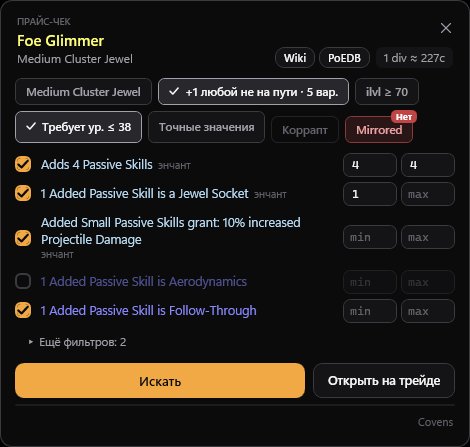

### А ещё
- **Настройки** в отдельном окне; интерфейс на русском или английском.
- **Синхронизация персонажа** по публичному профилю: отмечает гемы, которые уже стоят в шмотках, и сравнивает дерево
  с персонажем.
- **Alt+Tab**: пока впереди другая программа, оверлей становится прозрачным и пропускает клики.
- **Панель отходит в сторону**, когда открываете инвентарь.

  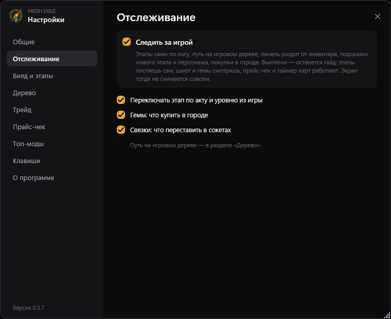

## Установка

1. Скачайте последний `FreshExile.zip` из **[Releases](https://github.com/freshexileapp/FreshExile/releases/latest)** и распакуйте куда угодно.
2. Запустите `FreshExile.exe`. Windows 10 / 11, 64 бита.
3. Вставьте ссылку pobb.in / pastebin или код PoB и нажмите **Загрузить билд**.
4. Переведите игру в режим **Windowed Fullscreen**.
5. Игра должна быть на **английском**: пока отслеживание по логу и прайс-чек читают только английские тексты игры.

Лог игры находится сам по запущенной игре; если нет — укажите его в *Настройки → Общие*.

С 0.3.9 программа обновляется сама: новый релиз скачивается в фоне и встаёт на место exe, когда вы её закрываете
(*Настройки → О программе*).

## Горячие клавиши

| Клавиши | Действие |
|---|---|
| `Ctrl+Alt+G` | показать / скрыть панель |
| `Ctrl+Alt+C` | панель: компактно / полностью |
| `Ctrl+Alt+T` | показать / скрыть окно дерева |
| `Ctrl+Alt+E` | окно дерева: сквозные клики вкл / выкл |
| `Ctrl+Alt+←` / `→` | предыдущий / следующий этап |
| `Ctrl+Alt+D` | прайс-чек предмета под мышкой (занят, только пока игра впереди) |
| `Ctrl+Alt+F` | поиск на трейде по названию (карты, уники, валюта…) без предмета; результат — в окне прайс-чека |

Все меняются в *Настройки → Клавиши*.

## По правилам GGG

Fresh Exile читает лог-файл игры и публичный API pathofexile.com и рисует своё окно поверх игры. В память игры не лезет.
В игру он посылает только `Ctrl+Alt+C` (скопировать предмет), по одному на нажатие клавиши прайс-чека, и Enter, Ctrl+V,
Enter — одно сообщение продавцу на нажатие **Написать**, как Awakened PoE Trade и похожие программы. Запросы к трейду — только по вашему действию и не чаще, чем
разрешает сайт. Наложение на дерево смотрит на снимок экрана игры; если выключить отслеживание в настройках, экран
не снимается совсем.

## Благодарности

- [Path of Building Community](https://github.com/PathOfBuildingCommunity/PathOfBuilding) — формат билда и раскладка кластеров.
- [grindinggear/skilltree-export](https://github.com/grindinggear/skilltree-export) — дерево пассивок и рецепты масел.
- [HeartofPhos/exile-leveling](https://github.com/HeartofPhos/exile-leveling) (MIT) — откуда берётся каждый гем.
- [RePoE](https://github.com/repoe-fork/repoe-fork.github.io) — тиры модов и нотабли кластеров.
- [poe.ninja](https://poe.ninja) — цены уников и валюты.

## Лицензия

[MIT](LICENSE).

Fresh Exile — фанатский проект, не связан с Grinding Gear Games и не одобрен ими.

Сборка из исходников: [docs/development.md](docs/development.md).
